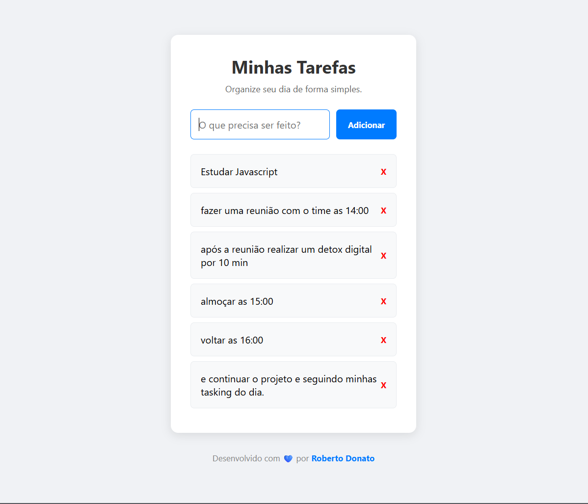

# 📝 Gerenciador de Tarefas

Um aplicativo web simples, moderno e funcional para organizar suas tarefas diárias. Este projeto foi construído do zero como parte dos meus estudos práticos de desenvolvimento Front-end, aplicando boas práticas de mercado, versionamento e código limpo.

## 🖼️ Preview do Projeto

## 🚀 Tecnologias e Conceitos Utilizados

- **HTML5**: Estruturação semântica.
- **CSS3**: Estilização moderna, layout responsivo com **Flexbox** e uso de variáveis e classes para separação de conceitos.
- **JavaScript (ES6+)**:
  - Manipulação avançada do DOM.
  - Delegação de eventos (`Event Delegation`) para melhor performance.
  - **LocalStorage** para persistência de dados.
  - Aplicação de **Clean Code** (funções com responsabilidade única e separação entre lógica e estilo).
- **Git e GitHub**: Versionamento com *Conventional Commits*.

## ⚙️ Funcionalidades

- [x] Estrutura base em HTML.
- [x] Design moderno e responsivo (mobile-first).
- [x] Adicionar novas tarefas via formulário.
- [x] Deletar tarefas da lista.
- [x] **Persistência de dados (LocalStorage)**: As tarefas não somem ao atualizar a página.
- [x] Favicon personalizado com SVG (sem arquivos externos).
- [ ] Marcar tarefas como concluídas (Próximo passo).

## 🧠 Como a Lógica Funciona (Bastidores)

1. **Adicionar Tarefa:** O formulário intercepta o evento de envio (`preventDefault`), extrai o texto, adiciona ao array de tarefas e salva no navegador.
2. **Deletar Tarefa:** Utiliza o conceito de *Event Delegation*. Um único "ouvinte" observa a lista inteira e, ao detectar o clique no botão "X" (identificado por uma classe), remove o item correspondente do array.
3. **Persistência:** O array de tarefas é convertido em texto (`JSON.stringify`) e salvo no `localStorage`. Ao carregar a página, o texto é convertido de volta para array (`JSON.parse`), garantindo que os dados não se percam.
4. **Clean Code:** Os estilos dos botões foram removidos do JavaScript e passados para o CSS, mantendo o código limpo e de fácil manutenção.

## 💻 Como rodar o projeto

1. Clone o repositório.
2. Navegue até a pasta `gerenciador-tarefas`.
3. Abra o arquivo `index.html` no navegador ou utilize a extensão **Live Server** no VS Code.

---
*Desenvolvido por [Roberto Donato](https://github.com/Robertocieno07)*